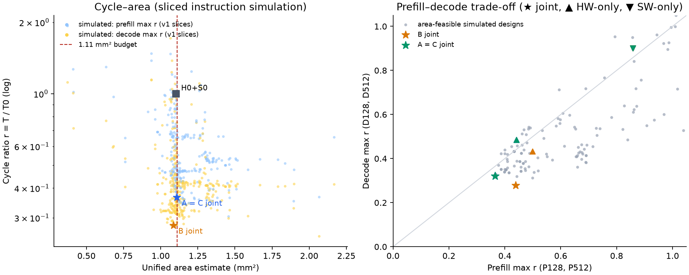

# Qwen A/B/C study, iteration 2: complete simulations of every task scenario

2026-10-09 (afternoon). Continues [iteration 1](../qwen-abc-study-20261009/README.md),
which stays unchanged. Same task, area model (unified-v4, 1.11 mm²), frozen memory
and T0. All numbers below are model predictions of the native instruction executor;
they are not RTL or silicon measurements.

## Result: complete simulations

Every scenario that enters a task score was simulated completely through
`prepare-qwen` + `instructions` (no slicing, all 24 layers, all 16 decode steps;
[validation.json](validation.json)):

| Design | Area mm² | Q-P128 | Q-P512 | Q-D128 | Q-D512 | Task max r |
|---|---:|---:|---:|---:|---:|---:|
| A (prefill) | 1.1078 | 0.3669 | 0.3632 | – | – | **0.367** |
| B (decode) | 1.0848 | 0.4300 | pending | 0.2791 | 0.2578 | **0.279** |
| C (all four) | 1.1078 | 0.3669 | 0.3632 | 0.3224 | 0.2951 | **0.367** |

A and C use the same hardware ([A_C-hardware.json](designs/A_C-hardware.json)),
B its own ([B-hardware.json](designs/B-hardware.json)). B's Q-P512 is only a
cross-evaluation entry and was still running when this was written.

Compared with iteration 1's complete simulations: A unchanged (0.367), B
0.313 → 0.279, C 0.378 → 0.367. Speedups against the frozen baseline:
A 2.73×, B 3.58×, C 2.73×.

Stars and triangles use v2 slices ([report](report/tables.md)); the background points are
every v1-sliced design of the search ([plot.py](plot.py); [PDF](tradeoffs.pdf), [SVG](tradeoffs.svg)).

Software per scenario ([designs/](designs/)): prefill uses sharing, GQA batching,
packed PV and the column-order GEMM kernels (32×64 tiles); decode uses sharing,
GQA batching, fusion and the new **trim** GEMM kernel.

## What changed in iteration 2

### Store path and the trim kernel

The executor writes stores through L1 without allocation and charges a full-line
DRAM write per touched line, holding an L1 write entry for a memory latency
(`lib.rs`, `global`). The original epilogue writes 32 B into two lines per store
instruction. Two compiled kernels were added in
[mma_stage_bf16.cl](../../../examples/kernels/mma_stage_bf16.cl) (same pinned LLVM;
bundle `tests/fixtures/compiled-transformer-ncol/`):

- `mma_trim_bf16`: rows below 4 live only in A fragment register 0, so m ≤ 4 loads
  that register only (decode GEMMs are m = 1); otherwise identical to the
  column-order kernel (98 VGPR, 14 SGPR).
- `mma_stage_bf16`: additionally stages each accumulator pair through 256 B of LDS
  and stores one full 128 B line per instruction (107 VGPR). The LDS buffer is a
  `__local` argument placed above the compiler LDS stack because the ELF provider
  starts that stack at the LDS base.

Decode (v2 slices, [v2c-decode](experiments/v2c-decode.json)):

| Hardware | original D128 | LDS-staged | trim |
|---|---:|---:|---:|
| B | 0.3129 | 0.2816 | **0.2791** |
| A=C | 0.3720 | 0.3384 | **0.3214** |

The trim kernel frees LSU and per-warp slots from loads of all-zero A registers.
LDS staging cost residency (more VGPRs) and did not pay off; for prefill (m ≥ 32)
neither variant helps on A=C ([v2-prefill](experiments/v2-prefill.json),
[ptrim](experiments/ptrim.json)). A trace test checks that every output byte of
both kernels is written exactly once (row/column tails, m = 1) and that staged
global stores each touch one line; the NumPy replay checks logits and KV caches.

### Evaluator v2

Decode slices now replay the previous step's tail (last layer, final norm, LM head)
before measuring step 8, so caches hold continuous-decode state; P128 and decode
sample layers 0–2. Against complete simulations:

| Run | complete | v1 slice | v2 slice |
|---|---:|---:|---:|
| A=C Q-D128 (direct software) | 0.3779 | 0.3627 (-4.0%) | 0.3720 (-1.6%) |
| B Q-D128 (direct) | 0.3127 | 0.3114 | 0.3129 (+0.1%) |
| A=C Q-P128 | 0.3669 | 0.3622 | 0.3656 (-0.4%) |
| A=C Q-D128 (trim) | 0.3224 | – | 0.3214 (-0.3%) |
| A=C Q-D512 (trim) | 0.2951 | – | 0.2925 (-0.9%) |

While adding v2, a filter for warm-up rows also dropped v1's separate LM-head slice
from decode estimates. It was caught when v1 and v2 disagreed by 25% for trim,
fixed before any reported result used it, and is covered by `tests/test_qwen_study.py`.

### Column order changes the hardware landscape

One-field sweeps around A=C under the column-order software
([ofat2-prefill](experiments/ofat2-prefill.json), [ofat2-decode](experiments/ofat2-decode.json))
show cache capacity now matters (concurrent blocks share weight strips), unlike
iteration 1's row-order sweeps: L1 ways 1 → 2 gives P128 0.3485 / D128 0.3038,
L2 ways 4 → 8 gives P128 0.3526, L2 MSHRs 32 → 64 gives D128 0.2824. All of these
exceed the budget on A=C. Three further MIP rounds for A with these samples found no
better feasible design; the last trust-region solves only had poor neighbours left
(all good budget-feasible neighbours were already simulated), so A=C is a local
optimum of this menu. C's prefill scenarios bind and A=C already reaches A's
prefill optimum, so C was not searched further. B's rounds with the trim kernel
converged at 0.2793 (v1); 3-SM decode candidates (0.32–0.36,
[sm3-trim](experiments/sm3-trim.json)) and (4,8,4) Tensor variants (0.288–0.30,
[t484-trim](experiments/t484-trim.json)) were worse: with trim, decode is limited by
SMs × L1 MSHRs and L2 capacity within the area budget.

## Controls

Task max r with estimator v2 ([report](report/tables.md), [summary](report/summary.json));
software is picked per scenario from the extended menu (column order, packed PV,
trim). Hardware-only designs are iteration 1's (searched with the original packed64
program).

| Task | Default H0+S0 | Software only | Hardware only | Software then hardware | Joint |
|---|---:|---:|---:|---:|---:|
| A | 1.0019 | 0.8581 | 0.4409 | 0.3656 | 0.3656 |
| B | 1.0037 | 0.9015 | 0.4325 | 0.2789 | 0.2789 |
| C | 1.0037 | 0.9015 | 0.4850 | 0.3656 | 0.3656 |

v2 puts H0+S0 at 1.0019 (P128) and 1.0018 (D128) against the complete baseline.
Sequential equals joint: the best H0 software (trim for decode, column order with
packed PV for prefill) is also the selected software on the final hardware. The
software gain grows with the hardware: on H0 software gives 10–14%; on the fixed A=C
hardware, packed64 gives P512 0.443 and D512 0.493 (iteration 1 ablation) against
0.361 and 0.293 with the final software, i.e. 18% and 41%.

## Limits

As in iteration 1: model predictions only, uncalibrated extended-ISA timing and
structural area estimates, optimality local to the surrogate and menu. The search
itself used v1 slices; final selection and every task score use complete
simulations.
