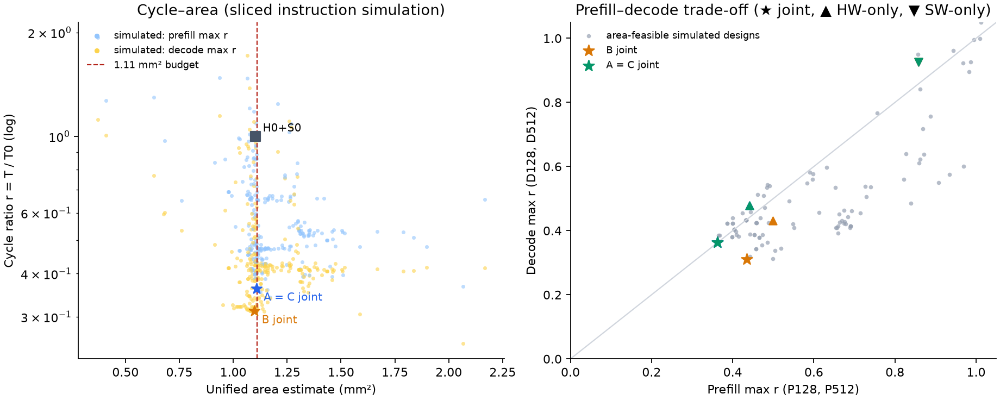

# Qwen A/B/C hardware–software co-design study

2026-10-09. Task: [project_tasks_cn.md](../../project_tasks_cn.md). Workflow and
commands: [qwen-abc-study.md](../../qwen-abc-study.md). Unified-v4 area model,
1.11 mm² budget, frozen external memory (1 channel, 64 B/cycle, 100 cycles),
32 threads, 128 B lines, fixed precision target. r(w) = T(H,S,w)/T0(w) with the
frozen baseline T0 (128 complete simulations, 512 labelled extrapolations).

All cycles are predictions of the native instruction executor on compiled ELF
programs. They are not RTL or silicon measurements; MIP optimality refers to
the fitted surrogate over the finite menu, never to the simulator.

## Result

Selected designs evaluated on all four scenarios (sliced estimate, see
[method](#evaluation-method)); software is chosen per scenario on the fixed hardware:

| Design | Area mm² | Q-P128 | Q-P512 | Q-D128 | Q-D512 | Task max r |
|---|---:|---:|---:|---:|---:|---:|
| A (prefill) | 1.1078 | 0.3622 | 0.3613 | 0.3627 | 0.3365 | **0.3622** |
| B (decode) | 1.0990 | 0.4290 | 0.4342 | 0.3114 | 0.2877 | **0.3114** |
| C (all four) | 1.1078 | 0.3622 | 0.3613 | 0.3627 | 0.3365 | **0.3627** |

A and C converged to the **same hardware**: the prefill-only search found nothing
better than the balanced design, so specialization gains nothing for prefill. B
is a different 2-SM design; its decode max r is 14% lower than A=C's and its
prefill max r 20% higher (cross-evaluation). B's LDS (32 KiB, 32 banks) is unused: the
cycle-identical 16 KiB/8-bank variant needs 1.0770 mm².

Complete (unsliced) simulations through `prepare-qwen` + `instructions`
([validation.json](validation.json)):

| Run | Complete r | Sliced r | Sliced error |
|---|---:|---:|---:|
| H0+S0 Q-P128 / Q-D128 (reproduction) | 1.0000 / 1.0000 | 0.9942 / 0.9965 | -0.6% / -0.4% |
| B Q-D128 (16 steps) | **0.3127** | 0.3114 | -0.4% |
| A=C Q-P128 | **0.3669** | 0.3622 | -1.3% |
| A=C Q-D128 (16 steps) | **0.3779** | 0.3627 | -4.0% |

The baseline reproduction matched the frozen receipts exactly (812,589,857 and
2,481,135,702 cycles; identical instruction counts). The sliced estimate starts
each slice cold. On A=C's small L2 (32 KiB) cache state left by earlier dispatches
slows decode layers by about 4%; on B's 512 KiB L2 the difference is 0.4%.
Using the complete 128 values and scaling each 512 estimate by its design's
measured 128 complete/sliced ratio (labelled estimate):

| Task | Validated max r | Binding scenario |
|---|---:|---|
| A | 0.367 (P128 complete 0.3669; P512 est. 0.366) | Q-P128 |
| B | 0.313 (D128 complete 0.3127; D512 est. 0.289) | Q-D128 |
| C | 0.378 (D128 complete 0.3779) | Q-D128 |

No 512 scenario was simulated completely; 512 values are sliced estimates.

## Five controls (task max r, sliced)

| Task | Default H0+S0 | Software only | Hardware only | Software then hardware | Joint |
|---|---:|---:|---:|---:|---:|
| A | 0.9945 | 0.8581 | 0.4409 | 0.3622 | 0.3622 |
| B | 0.9965 | 0.9257 | 0.4314 | 0.3114 | 0.3114 |
| C | 0.9965 | 0.9257 | 0.4781 | 0.3627 | 0.3627 |

Software only keeps H0 and picks the best program per scenario from every option.
Hardware only searches hardware with the original packed64 program. The
sequential control fixes the best H0 software (prefill: column order + packed PV +
32×64; decode: sharing + GQA batching + fusion) and then searches hardware.
Joint searches hardware with a software menu (tile × packed PV × block order).

The sequential control equals joint: the best H0 software was also best on the
selected hardware, so this study shows no extra gain from searching software
jointly. It does show a strong interaction: the same software that gains 7–14%
on H0 gains 8–32% on the selected hardware (18–32% on the 512 scenarios, below),
because H0 is limited by memory concurrency that software cannot remove.

## Where the gains come from

Software on the fixed A=C hardware ([abl-prefill](experiments/abl-prefill.json),
[abl-decode](experiments/abl-decode.json)):

| Software | Q-P128 | Q-P512 | Q-D128 | Q-D512 |
|---|---:|---:|---:|---:|
| original packed64 (S0) | 0.3952 | 0.4427 | 0.4307 | 0.4927 |
| + shared packing, GQA batching, decode fusion (S1) | 0.3949 | 0.4269 | 0.3627 | 0.3365 |
| + column-order GEMM kernels | 0.3696 | 0.4006 | – | – |
| + packed PV (final prefill) | 0.3622 | 0.3613 | – | – |

On H0: S1 gives D128 0.9257 (from 0.9965); the column-order kernels give P128
0.8554 and P512 0.8581 (from 0.99), because the original row-major block order
re-streams every weight strip once per row tile (4× at 128 rows, 16× at 512).

Hardware reverted one field toward H0 on A=C (final software):

| Reverted field | Area mm² | Q-P128 | Q-D128 |
|---|---:|---:|---:|
| none (A=C) | 1.1078 | 0.3622 | 0.3627 |
| L1 MSHRs 16 → 4 | 1.0786 | 0.5685 | 0.7358 |
| L1 write entries 16 → 4 | 1.0710 | 0.5634 | 0.4263 |
| SMs 3 → 2 | 0.7605 | 0.5154 | 0.5023 |
| LSU entries 16 → 8 | 1.0959 | 0.4611 | 0.5127 |
| Tensor (2,16,2) → (4,8,4) | 1.3094 (over budget) | 0.3501 | 0.3688 |

The selected designs buy memory-level parallelism: decode GEMMs stream weights
at only ~8 B/cycle on H0 (4 L1 MSHRs × 2 SMs against ~120-cycle round trips),
and prefill GEMMs are limited by outstanding loads and partial-line output
stores. The area is paid by resources without timing value here: LDS (bit-identical
cycles across capacity/bank/port sweeps, [lds](experiments/lds-decode.json)),
SGPRs 2048 → 256, RF collectors 8 → 4, L1 capacity, and a cheaper (2,16,2) Tensor
(half the MMA throughput of (4,8,4) per SM). RF banks/ports, collectors and
subentries had ≤4% single-field effects in the OFAT exploration.

L1 write entries, L2 MSHRs and LSU-per-warp interact strongly. Around the 3-SM OFAT
centre LSU-per-warp 8 alone was 1.09× (slower) and L2 MSHRs 64 alone 1.01×; around
the later incumbent (P128 0.433) the [factorial](experiments/fact-prefill.json) gave
LSU-per-warp 8 → 0.354 and with L2 MSHRs 64 → 0.341, while write entries 8 instead
of 16 → 0.468. This was found after the OFAT surrogate stalled at 0.433; pairwise
terms for these fields were then added to the MIP, which found the final design.

Selected hardware (bold: differs from H0):

| Field | H0 | B | A = C |
|---|---:|---:|---:|
| SMs / warps / blocks | 2 / 8 / 8 | 2 / 8 / 8 | **3** / 8 / 8 |
| collectors, VGPR, SGPR | 8, 1024, 2048 | 8, 1024, **256** | **4**, **512**, **256** |
| Tensor (m,n,k) × units | (4,8,4)×1 | **(2,16,2)**×1 | **(2,16,2)**×1 |
| LDS bytes / banks | 131072 / 32 | **32768** / 32 | **16384** / **8** |
| L1 sets×ways, MSHR, subentries, write entries | 256×2, 4, 2, 4 | 256×2, **16**, **1**, **16** | **64×1**, **16**, **1**, **16** |
| L2 sets×ways, MSHR | 64×16, 32 | **256**×16, 32 | 64×**4**, 32 |
| LSU entries / per warp | 8 / 4 | **16** / **8** | **16** / 4 |

RF banks 4 and read/write/writeback ports 1 are unchanged everywhere. Files:
[A_C-hardware.json](designs/A_C-hardware.json), [B-hardware.json](designs/B-hardware.json)
and the per-phase software JSONs in [designs/](designs/).

[PDF](tradeoffs.pdf) / [SVG](tradeoffs.svg). Left: every simulated design
(over-budget exploration samples included, marked by area). Right: area-feasible
designs simulated on all four scenarios.

## Software changes

All options extend packed64 and keep network, BF16 storage and FP32 accumulation;
layout conversions are timed dispatches ([workflow](../../qwen-abc-study.md#software-options)).

- **Shared packing**: q/k/v and gate/up reuse one packed activation.
- **GQA batching**: the 7 query heads of a KV head are contiguous in the head-major
  buffers, so QK and PV are one GEMM per KV head; decode also runs one softmax over
  the stack (every cached column is visible), prefill keeps per-head softmax.
- **Decode fusion**: packed B tiles are N-tile-major, so concatenating q/k/v or
  gate/up weights concatenates buffers; single-row outputs are contiguous.
- **Packed PV**: one chunked `transpose_append` per KV head writes V as MMA B tiles,
  then PV uses the packed kernels. The QK analogue needs an element transpose
  (2-byte scattered stores) that cost more than it saved and is not selected.
- **Column block order** (new compiled kernels): consecutive blocks take the row
  tiles of one weight strip, so concurrently resident blocks share it. Same
  registers (98/14 and 33/11 VGPR/SGPR), MMA sequence and outputs.

Functional checks: NumPy replay of the small configuration compares logits and all
KV caches against the original program for every option set, including row tails
and GQA decode, plus a dense reference for the GEMM kernels; a wrong K-tile
chunking mutation is detected. Each sliced dispatch also checks its dynamic MMA
count against the shape count. The local LLVM build reproduced the frozen
`reuse.elf` and `packed.elf` bytes before compiling the new kernels
([receipt](../../../tests/fixtures/compiled-transformer-ncol/ncol.build.json)).
The performance executor does not compute tensors; numerical equivalence is
established only by the replay at small size.

## Evaluation method

A scenario estimate simulates (1) prologue, layer 0 and epilogue (layer 0 × 24)
and (2) the LM head (identical work in every scenario), each cold; decode uses step
8 of 16. Baseline per-layer variation is ±2% and per-step <0.4%. Exploration used
one-field-at-a-time samples around three centres (2, 3 and 4 SMs; the 3-SM centre is
the [qwen-gemm pilot design](designs/centre-C3-qwen-gemm-pilot.json)), calibration
samples for each software variant, LDS sweeps, a memory factorial and hand-built
candidates; all are in [experiments/](experiments/). Over-budget samples teach the
surrogate and are never reported as designs.

## MIP and search effort

Surrogate per scenario: log cycles = one-hot hardware terms + 10 pairwise products +
tile-specific VGPR/SGPR/blocks/warps terms + software-variant offset, ridge strength
by leave-one-out error, 512 models shrunk toward the 128 model. Final leave-one-out
log errors 0.085 (P128, 330 samples), 0.103 (D128, 315), 0.036 (P512, 125),
0.039 (D512, 131); on MIP-selected
designs the mean absolute prediction error was 2–4% (8.5% for B hardware-only).
Constraints: unified area rows (`add_unified_area_constraints`), compiled-resource
rows, no-good cuts, trust region; one solve per phase software combination.

| Search | Rounds | MIP solves (optimal / time limit) | Best max r per round |
|---|---:|---|---|
| A joint | 8 | 24 / 83 | 0.4745 → 0.3622 |
| B joint | 8 | 30 / 28 | 0.3217 → 0.3114 |
| C joint | 8 | 18 / 107 | 0.4745 → 0.3627 |

Global solves over all fields mostly reached the time limit (no proof, incumbent
kept); trust-region solves around the incumbent were optimal for the surrogate in
seconds and produced most improvements. Totals ([stats.json](stats.json)):
1,400 simulated slices over 317 distinct hardware points, ~33 host CPU-hours
(local WSL, mostly 10–16 concurrent processes), all round receipts in
[rounds/](rounds/). Earlier rounds with weaker surrogates (no LDS exclusion, no
memory pairs, no column order) are preserved, not overwritten.
The rounds ran with HiGHS default threads; the committed solver now fixes one thread
and seed 0 (the process-wide HiGHS pool must match `codesign.solver`), so a rerun
can take different time-limited incumbents. Simulated results are unaffected.

## Limits

- Model predictions only; extended BF16 MMA timing is an uncalibrated target and
  cost v2/v4 is a structural estimate. No common-clock timing check of candidates.
- 512 results are sliced estimates; A=C decode shows the slicing can be ~4% optimistic.
- Optimality is local to the surrogate and menu; the simulator optimum is unknown.
- Joint and sequential coincide here; a different software menu (e.g. lower-register
  kernels, fused attention) could change that.
- QK in long prefill remains store-bound (about 17% of P512 cycles); a fused QK/softmax kernel
  is the most promising next software change.
