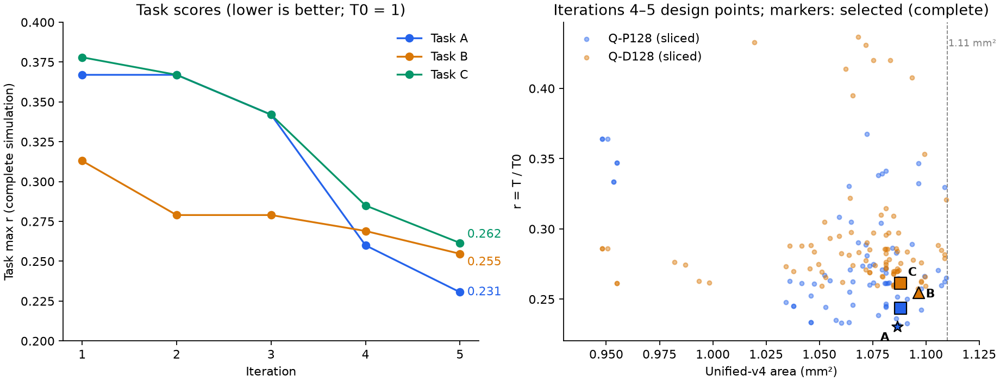

# Qwen A/B/C study, iteration 5: fused SwiGLU packing, multi-tile warps, new designs

2026-10-10 (night). Follows [iteration 4](../qwen-abc-study-20261010-iter4/README.md);
earlier iterations stay unchanged. Same task, unified-v4 area (1.11 mm²), frozen
memory and T0. Model predictions of the native instruction executor only.

## Result: complete simulations

| Design | Area mm² | Q-P128 | Q-P512 | Q-D128 | Q-D512 | Task max r | Speedup |
|---|---:|---:|---:|---:|---:|---:|---:|
| A (prefill): A5 | 1.0865 | **0.2306** | 0.2189 | _(0.2697)_ | _(0.2503)_ | **0.231** | 4.34× |
| B (decode): B2 | 1.0966 | _(0.3324)_ | _(0.3011)_ | **0.2547** | 0.2371 | **0.255** | 3.93× |
| (B1, for reference) | 1.0961 | – | – | 0.2576 | 0.2393 | 0.258 | 3.88× |
| C (all four): C11 | 1.0882 | 0.2435 | 0.2237 | **0.2615** | 0.2428 | **0.262** | 3.82× |

Bold entries bind the task. Entries in parentheses are sliced cross-evaluations
(not part of that task); every other entry is a complete `prepare-qwen` +
`instructions` run ([validation.json](validation.json)). Against iteration 4:
A 0.260 → 0.231, B 0.269 → 0.255, C 0.285 → 0.262.

([plot.py](plot.py); [SVG](progress.svg), [PDF](progress.pdf).)

Hardware ([designs/](designs/)); all three keep 2 SMs, 8 warps/blocks, L1 16 MSHRs,
1 subentry, 16 write entries, LSU 16/8 and LDS 16 KiB/8 banks:

| | VGPR | SGPR | collectors | Tensor | L1 | L2 | L2 MSHRs |
|---|---:|---:|---:|---|---|---|---:|
| A5 | 2048 | 256 | 8 | (4,8,4) | 64 × 4 | 64 × 16 | 32 |
| B2 | 1024 | 256 | 8 | (2,16,2) | 64 × 4 | 256 × 16 | 64 |
| C11 | 1024 | 256 | 8 | (4,8,4) | 64 × 4 | 128 × 16 | 32 |

Software (per phase, the same on every design): prefill uses sharing, GQA batching,
packed PV and QK, column order, 64×64 tiles for all multi-row GEMMs, the unrolled
epilogue, fused SwiGLU packing and `tiles_per_warp` {gate 2, up 2, lm_head 8};
decode uses sharing, GQA batching, fusion, the unrolled trim kernel, fused
SwiGLU packing and `tiles_per_warp` {gate_up 2, lm_head 8}.

## Controls

Task max r. Default and hardware-only use the original packed64 program; the
software-only row picks the best of the current menu per scenario on H0
([h0-pre](experiments/h0-pre.json), [h0-dec](experiments/h0-dec.json), v2 slices).

| Task | Default H0+S0 | Software only | Hardware only | Software then hardware | Joint |
|---|---:|---:|---:|---:|---:|
| A | 1.000 | 0.574 | 0.441 | 0.231 | 0.231 |
| B | 1.000 | 0.839 | 0.433 | 0.255 | 0.255 |
| C | 1.000 | 0.839 | 0.485 | 0.262 | 0.262 |

Default is the frozen baseline (complete). Hardware-only values are iteration 1's
searched designs with S0 (v2 slices, iteration 2 report). The software that is best on H0 (the
unrolled kernels with fusion and multi-tile warps) is also the selected software on
every final design, so sequential (software on H0, then hardware for that
software) and joint coincide. The software gain grew with the kernel work: on H0
the iteration-3 software gives P128 0.811 and D128 0.902, the current one 0.555
and 0.839.

## What changed

**Fused SwiGLU packing** ([fused_bf16.cl](../../../examples/kernels/fused_bf16.cl)):
one dispatch computes SiLU(gate)·up straight into the packed A tiles of the down
GEMM, replacing the row-major SwiGLU dispatch and the packing dispatch (the tiles
are bit-identical; replay checks logits and KV caches). N4 slices
([fz-pre](experiments/fz-pre.json)): P128 0.2613 → 0.2468, P512 0.2366 → 0.2244.

**Several tiles per warp** ([mma_multi_bf16.cl](../../../examples/kernels/mma_multi_bf16.cl)):
the kernel entry of the unrolled GEMMs saves ≈69/135 callee-saved vector
registers to the private stack; a warp that computes several tiles pays it once.
It only pays for GEMMs with many tiles: two tiles per warp everywhere slowed P128
(0.2613 → 0.2686) and decode with four tiles slowed D128 (0.2858 → 0.3146), since
14-tile GEMMs then occupy fewer warps ([tpw-pre](experiments/tpw-pre.json),
[tpw-dec](experiments/tpw-dec.json)). Per GEMM class (gate_up 2, LM head 8) it
gives D128 0.2717 on N4 and 0.2592 on B ([fz-dec](experiments/fz-dec.json)).

**Hardware.** With store traffic gone, single-field sweeps around N4 and B
(iteration 4) showed L1 capacity no longer matters (128 → 64 sets frees 0.034 mm²).
Paired moves ([r2](experiments/r2-pre.json), [r3](experiments/r3-pre.json),
[r4](experiments/r4-dec.json)) spend it differently per task:

- A: VGPR 2048 keeps 8 instead of 6 warps of the 166-VGPR 64×64 kernel resident
  (P128 0.2613 → 0.2501 before fusion); 16 warps per SM was worse (0.265).
- C: decode binds, so L2 128 sets and 8 collectors (D128 0.2609) instead of
  VGPR 2048; prefill (0.244) keeps slack.
- B: L1 64 sets pays for L2 64 MSHRs (B1, D128 0.2592 → 0.2575), and SGPR
  128 → 256 (B2, 0.2548): the multi-tile kernel needs 21 SGPRs, so 128 allowed
  only 6 warps per SM. Complete: B1 0.2576, B2 0.2547.

Single-field neighbourhoods of A5, C11 and B1 with the final software
([nls5-pre](experiments/nls5-pre.json), [nls5-dec](experiments/nls5-dec.json)) found
no improving move other than B's SGPR (above).

**MIP.** One sequential-policy round for C with this software fixed
(`qwen_abc --policy sequential`, surrogate on 47–117 v2 samples per scenario,
leave-one-out log error 3–10%; [mip5-C](experiments/mip5-C.json)) simulated nine
proposals. None beat C11 (best 0.2656; both radius-1 proposals worse, so C11 is also
a local optimum of the surrogate's trust region). Its global and radius-3/4
proposals with tensor_n 2 or 4-way L2 were predicted at 0.23 and simulated at
0.58: those levels have almost no samples under the new software. The new
designs themselves came from kernel analysis and simulator-driven local search,
as in iteration 3.

## Limits

As before: model predictions, uncalibrated extended-ISA timing, structural area,
local optimality of a finite menu and of simulator-driven neighbourhoods. Decode
is bound by L1 MSHRs × SMs (16 × 2 outstanding misses against a 100-cycle memory);
within 1.11 mm² a third SM costs more area than it can recover.
